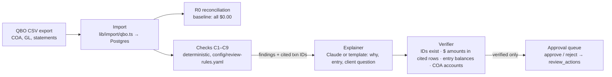

# Close Review

**A reconciled account doesn't mean the books are right.** Bank reconciliation proves the cash side matches the statement. A close built on reconciliation alone can still miss a rent bill that was never entered, the same invoice paid twice under two vendor names, a laptop coded to office supplies, an annual policy expensed in one month, an unaccrued utility bill, or a swing nobody explained. Every one of those clears the bank or never touches it.

Close Review is a prototype of a review layer on top of the close. It reads a client's QuickBooks-style ledger, runs deterministic review checks, and puts each finding in an approval queue with the exact ledger rows it cites, a plain-English explanation, and a balanced adjusting entry. AI prepares; the reviewer approves. It's a review layer I'd love to build with Cranston.

> Synthetic data only: "Harbor & Pine Coffee Co., LLC" is fictional. The review rules are an **illustrative sample checklist, not accounting advice**.

 <!-- TODO: record with ?record=1 -->

## Results

On a synthetic client with 15 planted errors, every bank and card account reconciled to $0.00, so the books "closed clean". Close Review caught **14 of 15**, each with a cited, balanced fixing entry, flagged **0 of 10** decoys, and raised **1** other false alarm. Numbers come from [`results/metrics.json`](results/metrics.json); details in [`results/findings.md`](results/findings.md).

| | Caught | Decoys flagged | Other false alarms |
|---|---|---|---|
| Bank & card reconciliation (3/3 accounts, 9/9 month-ends at $0.00) | 0/15 | n/a | n/a |
| Close Review (C1–C9) | **14/15** | **0/10** | **1** |

Explanations verified 15/15; entries balanced 15/15. Cost per close: $0 in replay, about 30 ms of checks over 379 transactions. The shipped `public/demo/run.json` uses the deterministic template explainer (no API key was used to build it); set `ANTHROPIC_API_KEY` and rerun `npm run eval` to regenerate with Claude.

### Planted errors

| # | Planted error | Check | Result |
|---|---|---|---|
| 1–2 | September rent ($4,200) and internet ($189) never recorded | C1 missing recurring | caught |
| 3–4 | Same invoice paid twice to near-duplicate vendor names; both cleared the bank | C2 duplicate payment | caught |
| 5–7 | Laptop to Office Supplies; Square fees to Meals; owner's Netflix to Software | C3 wrong account | caught |
| 8 | $6,000 annual insurance expensed in July | C4 prepaid | caught |
| 9 | September utilities (billed Oct 12) not accrued | C5 accrual | caught |
| 10–11 | Repairs up 340% with no memo; milk COGS down 56% with revenue flat | C6 flux | caught |
| 12 | $5,000 round JE to Miscellaneous, no memo | C7 manual JE | caught |
| 13 | Oct 2 catering event invoiced in September | C8 cut-off | caught |
| 14 | Q2 sales tax payable never remitted | none in the sample list | **missed** |
| 15 | Accrued Expenses carrying a debit balance | C9 balance sanity | caught |

Decoys (must not be flagged) include equal payments to one vendor with different invoice numbers, two similarly named espresso vendors, a properly prepaid annual subscription, a monthly insurance premium over $2,000, a memo'd one-time repair, and a memo'd marketing push. See `data/ground_truth.json`.

## How it works



- **Only checks create findings.** The LLM gets one finding plus its cited rows and returns `why`, `proposed_entry`, and an optional `client_question` (JSON schema output, `claude-sonnet-5-5`), cached by `(finding_id, prompt_hash)` in `cache/explain/`. Code verifies it; on failure it retries once, then shows "explanation unavailable" and never an unverified entry.
- **R0** matches ledger cash lines to statement lines (same amount, posted within 7 days) and reports outstanding items. It raises no findings: that's the point.

| Check | Rule (sample thresholds) |
|---|---|
| C1 | Vendor+account in every prior month (±10%, ≥$100), absent now |
| C2 | Vendor names Jaro-Winkler ≥0.85 **and** (same invoice # **or** same amount within 14 days, unless invoice #s differ) |
| C3 | Keyword rules, vendor's usual account (≥90% of ≥3 lines), ≥$1,500 in a capex-candidate account |
| C4 | Expense ≥$2,000 whose memo or vendor implies a term; reclass the unexpired months |
| C5 | Recurring vendor with no expense this month and a next-month invoice whose service date is this month |
| C6 | Current vs prior average, after removing other findings' txns and new memo'd items; flag ≥35% and ≥$500 |
| C7 | Manual JE with 2+ of: round ≥$1,000, Misc/Suspense account, no memo |
| C8 | P&L line whose service date is in a different month than its posting date |
| C9 | Liability with a debit balance / asset with a credit balance at period end |

## Run it

```bash
npm install
npm run dev            # replay mode at http://localhost:3000, no keys or database needed
```

Full pipeline:

```bash
cp .env.example .env   # DATABASE_URL, optional ANTHROPIC_API_KEY, DEMO_PASSWORD for live mode
docker compose up -d
npm run db:push        # create tables
npm run generate       # synthetic books → data/qbo/*.csv, data/ground_truth.json
npm run import:sample  # load into Postgres, check debits = credits
npm test               # one positive and one decoy per check, R0 at $0.00
npm run eval           # metrics, findings.md, public/demo/run.json
```

- **Replay** (default): "Run close review →" animates the pipeline from `public/demo/run.json`. "Show me the gap" opens and approves three findings in turn.
- **Live mode** (needs `DEMO_PASSWORD`): upload QBO-shaped CSVs or use the sample client to run the real pipeline. Column mapping: [`docs/qbo-mapping.md`](docs/qbo-mapping.md).
- **Recording**: `?record=1` gives a fixed 1280×720 frame with larger type.
- Approve/reject writes to `review_actions` when `DATABASE_URL` is set.

Deploy: Vercel or Render with no env vars gives replay mode; add `DEMO_PASSWORD` (and optionally `DATABASE_URL`, `ANTHROPIC_API_KEY`) for live mode.

## Layout

```
scripts/generate.ts      synthetic client, plants, decoys, statements
lib/import/qbo.ts        CSV → Books;  db/schema.ts, lib/db.ts  Postgres (Drizzle)
lib/review/              r0.ts reconciliation, checks.ts C1–C9, checks.test.ts
lib/explain.ts           Claude / template explainer;  lib/verify.ts  verifier;  prompts/explain.md
scripts/eval.ts          metrics.json, findings.md, public/demo/run.json
components/close-review.tsx, app/(app)/clients/[id]/close   the UI;  app/(app)/whats-next   1120-S slide
```

## Limitations

- Synthetic data, one fictional client, one quarter; the same author planted the errors and wrote the checks.
- A small sample checklist with hand-picked thresholds. Not accounting advice.
- No real QuickBooks connection and no write-back to any ledger.
- One false alarm (cups flux) from a legitimate one-off in the baseline; one miss (stale sales tax liability) because no check ages liabilities.
- I haven't used Cranston's product (there's no free trial), so nothing here assumes how its close works.
